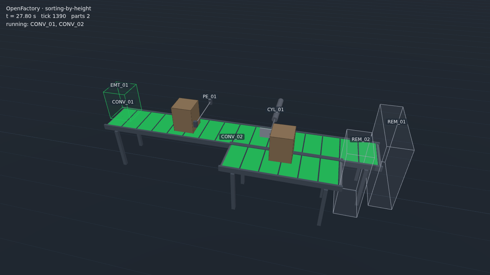

# OpenFactory

**An open-source 3D factory and process simulator for PLC training, prototyping, and demos.**

Write a plant as a YAML file. Run it. Connect a real PLC, a soft PLC, or an emulator over Modbus TCP,
EtherNet/IP, or OPC UA. Watch it move in your browser.

> Status: **Milestone 1, walking skeleton.** One scene (`scenes/sorting-by-height.yaml`) runs headless
> or in the browser, and sorts boxes under a free soft PLC: see the
> [OpenPLC quickstart](docs/guides/openplc-quickstart.md). [`docs/PLAN.md`](docs/PLAN.md) has the roadmap.

*OpenPLC v3 in control over Modbus TCP: tall boxes trip the photo eye and are pushed onto the
divert lane; short boxes pass under it (30 s video, click the picture).*

## Why

Commercial 3D simulators are excellent but closed, and their scenes are built by hand in an editor. We wanted
a simulator where:

- **Scenes are text.** Version them, diff them, generate them with scripts or with an AI assistant.
- **Anyone can run it.** Browser viewer, Python core, no license server. Free soft PLCs like OpenPLC work
  out of the box.
- **Process matters.** Tanks, valves, pumps, and PID loops are first-class, not an afterthought.
- **It plugs into real tooling.** A scene exports an I/O list that becomes Studio 5000 tags and Ignition
  UDTs with the same engineering workflow used on real projects.

## Planned Features

| Area | Milestone 1 | Later |
|------|-------------|-------|
| Components | Belt conveyor, photo eye, pusher cylinder, box emitter/remover, pushbutton, pilot light | Roller conveyor, turntable, pick-and-place, tank, valve, pump, PID, VFD |
| Protocols | Modbus TCP server | EtherNet/IP (ControlLogix / Logix Emulate), OPC UA, MQTT Sparkplug B |
| Viewer | Three.js + Rapier, orbit camera, state overlay | In-browser scene editor, multi-user view |
| Export | I/O list CSV | Ignition tag JSON, L5X tag stubs, GRAFCET sequence doc |
| PLC examples | OpenPLC Structured Text | Studio 5000 L5X, CODESYS |

## License

Code is Apache-2.0. Models, textures, and documentation are CC-BY-4.0. See [`LICENSE`](LICENSE) and
[`CONTRIBUTING.md`](CONTRIBUTING.md), including the clean-room policy.

## Safety

OpenFactory is a training and demonstration tool. It is not a safety-rated simulator.

---

Built by [HIS Controls](mailto:Timothy.hunt.his@outlook.com), a Rockwell Automation and Inductive Automation
systems integrator serving California.
