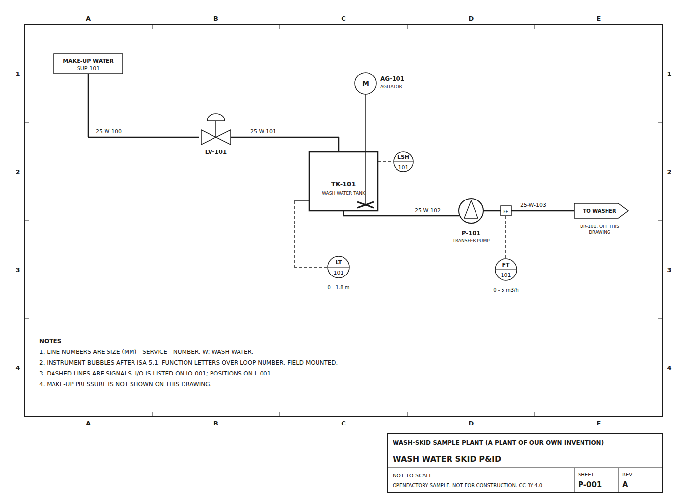
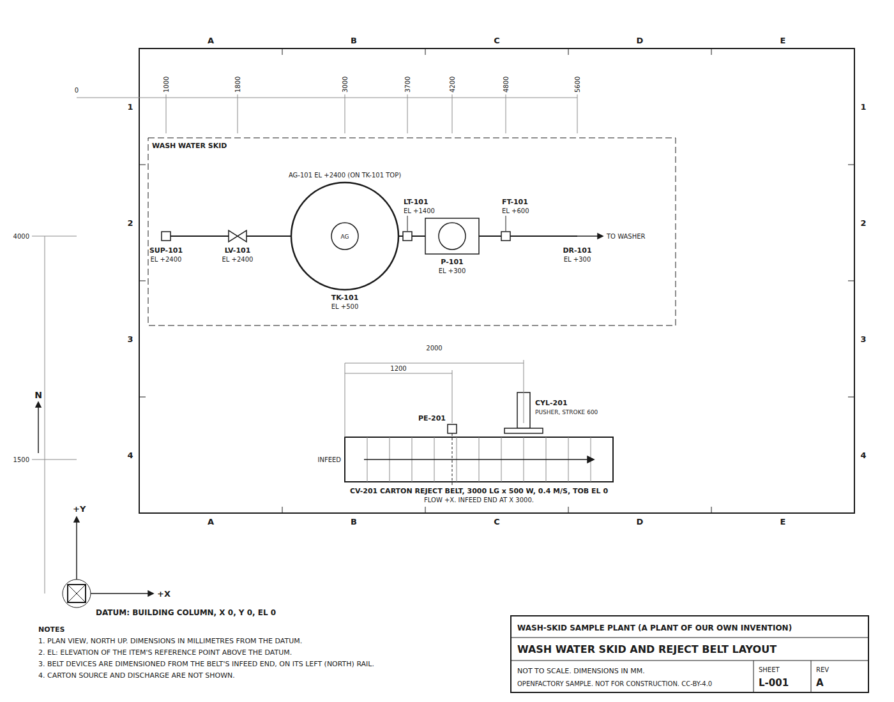

# Authoring a plant from its drawings

This page is for an assistant (or a person) turning a plant's drawings into an OpenFactory
scene: P&IDs, a layout sheet and an I/O list in, a scene a person has checked out (PLAN 5.13).
It covers the steps in the order you work: what to ask first, reading each kind of sheet into a
**takeoff**, checking it, and making the scene from it.

OpenFactory is a training and demo tool. **It is not a safety-rated simulation**, and a scene
made from drawings is a picture of the plant for training, demos and testing PLC programs. It is
never a safety model of the plant, and nothing in it replaces the plant's own engineering.

The takeoff is the reviewed middle step. Reading a drawing is error-prone, so you never type a
scene from the drawings. You write a table, a person checks it against the drawings row by row,
and the tool makes the scene from the table. The file's full reference is
[the takeoff page](takeoff.md); this page has what you need to write one.

## 1. Before you start: ask the person

Ask these before reading anything, and write the answers down:

1. **Which sheets, at which revision.** The P&IDs, the layout (general arrangement) sheet, and
   the I/O list, each with its sheet id and revision letter as printed in its title block.
2. **Where the work lives.** A customer's drawings, and every takeoff, scene and review made
   from them, stay in the customer's private project folder. **Never copy them into the
   OpenFactory repository**, and never put a customer name, tag list or drawing content in an
   issue, a commit or a public page (section 8).
3. **The layout sheet's datum.** Where its datum point (the point its dimensions are measured
   from) should sit in the scene, in metres. With no answer, use `[0, 0, 0]` and say so.
4. **What is off the drawings.** Where lines come from and go to past the sheet edge (a header,
   another area, a consumer), and their pressures if known.
5. **Equipment with no type yet.** OpenFactory has a fixed set of types (section 3). Agree that
   anything else becomes a stand-in (`type: unknown`) that carries its I/O, for now.
6. **For a demo or a test: the sequence of operations.** The takeoff holds equipment, lines and
   I/O, not behaviour; a scene's checks are written later from the sequence. With no answer,
   treat it as a demo (section 7).

When there is no one to ask, take the default each question gives and write the question down
anyway. A `drawings` entry has no questions of its own: a question about a sheet (its
revision, the datum) goes on the first row you read from that sheet, and a question about the
whole job (the work folder, the sequence) on the first equipment row.

## 2. Practise on the sample

`docs/samples/wash-skid/` is a plant of our own invention, drawn for practice and for the tests
(CC-BY-4.0): a P&ID, a layout and an I/O list, and the takeoff read from them. Read the sheets
yourself, write your own takeoff, then compare it with the shipped one.





The I/O list is `samples/wash-skid/IO-001.csv`.

## 3. The takeoff file

A takeoff is one YAML file, `<plant>.takeoff.yaml`, kept beside the drawings. It has six keys,
in this order: `takeoff`, `plant`, `drawings`, `equipment`, `connections`, `io`. A seventh,
`checked`, is written by the tool when a person checks the file; never write it yourself.

This example is an invented rinse station (not the sample):

```yaml
takeoff: "0.1"
plant: {name: rinse-station, description: Rinse tank with a feed valve and a return pump.}
drawings:
  - {id: P-310, kind: pid, title: Rinse Station P&ID, rev: C}
  - {id: L-310, kind: layout, title: Rinse Station Layout, rev: B,
     frame: {units: mm, datum: [0, 0, 0], rotation_deg: 0}}
  - {id: IO-310, kind: io_list, title: Rinse Station I/O List, rev: B}
equipment:
  - {row: EQ-1, tag: SUP-310, type: supply, description: Rinse Water Supply,
     params: {pressure_bar: 3.0}, ref: [{sheet: P-310, grid: A2}], confidence: assumed,
     questions: ["Supply pressure not shown; 3 bar assumed."]}
  - {row: EQ-2, tag: XV-310, type: valve_onoff, description: Rinse Tank Feed Valve,
     ref: [{sheet: P-310, grid: B2}, {sheet: L-310, grid: A1}],
     layout: {sheet: L-310, x: 900, y: 2500, elevation: 2100}, confidence: read, questions: []}
  - {row: EQ-3, tag: RT-310, type: tank, description: Rinse Tank,
     params: {diameter: 0.9, height: 1.4, hi_level: 1.2},
     ref: [{sheet: P-310, grid: C2}, {sheet: L-310, grid: B1}],
     layout: {sheet: L-310, x: 2000, y: 2500, elevation: 400}, confidence: read, questions: []}
  - {row: EQ-4, tag: TT-310, type: transmitter, description: Rinse Tank Temperature Transmitter,
     params: {measures: RT-310.temperature, range: [0, 100]},
     ref: [{sheet: P-310, grid: C3}], confidence: read, questions: []}
  - {row: EQ-5, tag: MX-310, type: unknown, description: Rinse Tank Mixer,
     params: {length: 0.4, width: 0.4, height: 0.5}, ref: [{sheet: P-310, grid: C1}],
     confidence: read, questions: ["No mixer type; a stand-in until there is one."]}
  - {row: EQ-6, tag: CV-320, type: belt_conveyor, description: Rinse Exit Belt Conveyor,
     params: {length: 2.5, width: 0.4, speed_mps: 0.3}, ref: [{sheet: L-310, grid: B3}],
     layout: {sheet: L-310, x: 1500, y: 800, elevation: 0}, confidence: read, questions: []}
  - {row: EQ-7, tag: PE-320, type: photo_eye, description: Rinse Exit Belt End Photo Eye,
     params: {beam_length: 0.5}, ref: [{sheet: L-310, grid: C3}],
     mount: {conveyor: CV-320, sheet: L-310, along: 2200, rail: right}, confidence: read,
     questions: []}
connections:
  - {row: CN-1, from: SUP-310, to: XV-310, line: 20-RW-311, ref: [{sheet: P-310, grid: A2}],
     confidence: read, questions: []}
  - {row: CN-2, from: XV-310, to: RT-310.top, line: 20-RW-312, ref: [{sheet: P-310, grid: B2}],
     confidence: read, questions: []}
io:
  - {row: IO-1, equipment: XV-310, port: open, signal: DO, plc_tag: XV310_Open,
     ref: [{sheet: IO-310, row: 1}], confidence: read, questions: []}
  - {row: IO-2, equipment: RT-310, port: hi_sw, signal: DI, plc_tag: LSH310,
     ref: [{sheet: IO-310, row: 2}], confidence: read, questions: []}
  - {row: IO-3, equipment: TT-310, port: pv, signal: AI, plc_tag: TT310_PV,
     range: [0, 100], units: degC, ref: [{sheet: IO-310, row: 3}], confidence: read,
     questions: []}
  - {row: IO-4, equipment: MX-310, port: run, signal: DO, plc_tag: MX310.Run,
     ref: [{sheet: IO-310, row: 4}], confidence: read, questions: []}
```

Each key, in full:

- **`plant`**: `name` (lower case, hyphens), `description` (one sentence), optional `author`.
- **`drawings`**: one entry per sheet: `id` as printed, `kind` (`pid`, `layout` or `io_list`),
  `title`, `rev`. A layout sheet also carries a `frame` (section 5). A list with no title
  block (a bare CSV) takes its file name without the extension as `id`, a title in words, and
  `rev: "-"`, with a question on its first row asking for its revision.
- **`equipment`**: one row per piece of equipment or instrument that the scene shows:
  - `row`: `EQ-1`, `EQ-2` and so on, in the order you read them, never reused;
  - `tag`: as printed (`RT-310`); the scene id is the tag with `-` as `_` (`RT_310`). Every
    other row names the item by this tag (a connection's ends, an `io` row's `equipment`),
    never by an I/O list's own component column;
  - `type`: one of the types below, or `unknown`;
  - `description`: what it is, in words, the equipment first (`Rinse Tank Temperature
    Transmitter`, not `TT 310`); one line;
  - `params`: the type's values as the drawing gives them (only names the type has);
  - `ref`: every place the row appears: `{sheet, grid}` for a drawing (the grid zone, column
    letter then row number, as `C2`), `{sheet, row}` for a list;
  - its position, at most one of `layout`, `mount`, `at` (section 5), or none;
  - `confidence` and `questions` (section 7).
- **`connections`**: one row per line between two pieces of equipment: `row` (`CN-1`, ...),
  `from` the upstream end and `to` the downstream end, each an equipment tag, optionally with
  the port the line meets (`RT-310.top`, `P-101.suction`); `line` the line number as printed;
  `ref`, `confidence`, `questions`.
- **`io`**: one row per point of the I/O list: `row` (`IO-1`, ...), `equipment` (the tag),
  `port` (the type's port, from the table), `signal` (`DI`, `DO`, `AI` or `AO`, the port's
  kind), `plc_tag` (the plant's own PLC name as printed), `range` and `units` for an analog,
  `ref` (`{sheet: <list id>, row: <n>}`, the list's row number counting data rows from 1),
  `confidence`, `questions`.

Every text is one line: no line breaks, no tabs. Use flow style (`{...}`, `[...]`) as above,
and put in double quotes any text that holds a `,`, `:`, `#`, `{`, `}`, `[` or `]` (in flow
style a comma ends the value).
No anchors, aliases or `<<` merge keys, and no key twice in one mapping; `check` refuses them.

### Types

Use these names in `type`. **Needs** are the parameters with no default: give them, or the
row cannot be placed (the scaffold reports it). Other parameters have defaults and may be left
out. **I/O ports** are what an `io` row's `port` and `signal` may be. **Line ends** are the ports
a connection may name on it.

| Type | Use it for | Needs | I/O ports | Line ends |
|---|---|---|---|---|
| `belt_conveyor` | a belt conveyor | `length`, `width`, `speed_mps` | `run` DO, `speed` AO, `running` DI, `reverse` DO | |
| `roller_conveyor` | a roller conveyor | `length`, `width`, `speed_mps` | `run` DO, `speed` AO, `running` DI, `reverse` DO | |
| `turntable` | a turntable or turning transfer | `length`, `width`, `speed_mps` | `run` DO, `turn` DO, `running` DI, `at_0` DI, `at_90` DI | |
| `lift` | a lift or elevator section | `length`, `width`, `speed_mps`, `lift_height` | `run` DO, `raise` DO, `running` DI, `at_top` DI, `at_bottom` DI | |
| `photo_eye` | a photo eye across a belt | `beam_length` | `detect` DI | |
| `pusher` | a pusher or reject cylinder | `stroke`, `extend_time_s` | `extend` DO, `extended` DI, `retracted` DI | |
| `stopper` | a stop blade | | `raise` DO, `raised` DI, `lowered` DI | |
| `diverter_arm` | a swinging diverter arm | `length` | `extend` DO, `extended` DI, `retracted` DI | |
| `distance_sensor` | an analog distance or height sensor | | `distance` AI, `switching` AI | |
| `color_sensor` | a colour or mark sensor | `teach` | `match` DI, `detect` DI | |
| `pick_and_place` | a pick-and-place unit | `travel`, `stroke` | `traverse` DO, `lower` DO, `grip` DO, `at_pick` DI, `at_place` DI, `lowered` DI, `holding` DI, `contact` DI | |
| `box_emitter` | a parts source for a demo | `interval_s`, `parts` | `enable` DO | |
| `part_remover` | a parts sink past a belt's end | `size` | | |
| `tank` | a tank or vessel | | `level` AI, `hi_sw` DI, `lo_sw` DI, `temp` AI | `bottom`, `top` and its named nozzles |
| `supply` | a line from off the drawing, at a pressure | | | `outlet` |
| `drain` | a line to off the drawing, or an open outlet | | | `inlet` |
| `junction` | a tee where lines meet | | | `node` |
| `valve_onoff` | an on/off valve | | `open` DO, `opened` DI, `closed` DI | `inlet`, `outlet` |
| `valve_control` | a control valve | | `position` AO, `position_fb` AI | `inlet`, `outlet` |
| `pump` | a pump | | `run` DO, `speed` AO, `running` DI, `flow` AI | `suction`, `discharge` |
| `heater` | a heater in a tank | `tank` | `on` DO, `power` AO, `temp` AI | |
| `transmitter` | a transmitter: level, flow, pressure, temperature | `measures`, `range` | `pv` AI | |
| `vfd_motor` | a variable-speed drive on a pump or belt | `drives` | `run` DO, `speed` AO, `reset` DO, `running` DI, `speed_fb` AI, `fault` DI | |
| `pushbutton` | a push button | | `pressed` DI | |
| `pilot_light` | a pilot light | | `on` DO | |
| `selector_switch` | a selector switch | | `pos_a` DI, `pos_b` DI | |
| `counter_display` | a numeric display | | `value` AO | |
| `scenery` | a body with no I/O (a platform, a panel) | | | |
| `unknown` | anything else: a stand-in carrying its I/O | | any names you choose | |

**A needed parameter the drawings do not print.** Never make one up silently and never scale
it off a sheet marked "not to scale". Either leave it out and ask (the scaffold then reports
the row *unplaced* until someone gives it; `takeoff check` does not report a missing parameter),
or, only when the person asks for a scene to look at now, give a typical value with the row marked
`assumed` and a question naming the value. The same holds for any parameter with a default:
leave it out unless the drawing gives it. With no one to ask, leave it out and ask.

**Which type**, from the tag's letters (ISA-5.1) and the I/O: a valve with an analog command
and a positioner (`LV`, `FV`, `PV`, `TV`, a diaphragm actuator) is a `valve_control`; one
opened and closed by a discrete output (`XV`, a solenoid) is a `valve_onoff`; `P` a `pump`;
`TK` or `T` a `tank`; `LT`, `FT`, `PT`, `TT` a `transmitter`; `CV` a conveyor (belt unless the
drawing says rollers); `PE` a `photo_eye`; a cylinder (`CYL`) that pushes off a belt a `pusher`;
a motor (`M`) on a tank top an agitator, `unknown`.

Parameters that name another row use its tag: a transmitter's `measures` is
`<TAG>.level`, `<TAG>.temperature`, `<TAG>.flow` (on a pump or valve: the flow through it) or
`<TAG>.pressure` (on a junction); a heater's `tank` and a drive's `drives` are the tag. The
units of the common parameters: lengths in metres, `speed_mps` in m/s, `stroke` in metres,
`extend_time_s` in seconds, `pressure_bar` in bar, `design_flow_m3h` in m³/h, `design_head_m`
in metres, a valve's `kv` in m³/h at 1 bar; a tank's `diameter`, `height`, `initial_level`,
`hi_level` and `lo_level` in metres. Write a value the drawing gives in other units in these.

## 4. Reading a P&ID

Work across the sheet zone by zone, and write a row for each thing as you meet it.

- **Equipment.** Every tank, pump, valve, conveyor and motor-driven item is an equipment row:
  its tag as printed, its type from the table, its grid zone in `ref`. The data printed beside
  it (a tank's size, a pump's duty, a valve's kv, notes on the sheet) are its `params`.
- **Instruments.** An instrument bubble that transmits (`LT`, `FT`, `PT`, `TT`) is a
  `transmitter` row whose `measures` names what it reads; its `range` and units come from the
  I/O list. A flow element drawn with its transmitter (`FE` and `FT` on one line) is the one
  transmitter row. **A level switch on a tank** (`LSH`, `LSL`) is not a row of its own: it is
  the tank's `hi_sw` or `lo_sw` port, used by an `io` row, and its set point, if printed, is
  the tank's `hi_level` or `lo_level`.
- **Lines.** Every line between two pieces of equipment is a connection row, from upstream to
  downstream (follow the flow arrows), with its line number. Name the port where it matters:
  a tank's `top` or `bottom` (or a nozzle the drawing names); a pump's `suction` and
  `discharge`. A line that passes through an instrument (a flow element) runs between the two
  pieces of equipment on either side of it; the instrument is not a line end.
- **Lines off the drawing.** A line that arrives from past the sheet edge starts at a `supply`
  row; one that leaves ends at a `drain` row. What lies past the edge (a header, the next
  machine) is not on the drawing, so the row is `confidence: assumed` even when the sheet draws
  and tags the line's end (then give its grid and its position as for any item), with a
  question: the supply's pressure, what the drain stands for. Connections into and out of a
  valve need no port names; a pump's are `suction` and `discharge`.
- **Something with no type** (an agitator, a mixer, a fan with no type here) is
  `type: unknown`, with `length`, `width` and `height` in metres if the layout gives them, and
  a question. It becomes a stand-in that carries its I/O rows.
- **Grid zones.** `ref` lists every zone the item is drawn in on each sheet (an element in one
  zone and its bubble in the next: both). For an item across a zone boundary, use the zone that
  holds its reference point (section 5: a belt's infeed end, a tank's centre). A connection's
  `ref` is the zone its line number is printed in.

## 5. Reading the layout sheet

A layout sheet gives positions. Copy them as printed; the tool converts them to the scene.

- **The frame**, on the sheet's `drawings` entry: `units` the dimensions are printed in (`mm`,
  `m`, `in`, `ft`); `datum`, where the sheet's datum sits in the scene, in metres (the
  person's answer to question 3, else `[0, 0, 0]`); `rotation_deg`, 0 when the sheet's x runs
  along the scene's x (the usual case: x to the right, north up).
- **A position as printed**, `layout: {sheet, x, y, elevation}`: the item's ordinates from the
  datum, `x` along the sheet to the right, `y` up the sheet, `elevation` its height above the
  datum (an `EL` figure), all in the sheet's units. Use the point the sheet dimensions for each
  type: a tank's centre (its elevation the bottom of the tank); a pump, valve, supply or drain
  at its line (its elevation the line's); a transmitter where it is drawn; a conveyor the
  centre of its **infeed end** (the end parts arrive at; its elevation the belt top). A
  conveyor drawn running other than to the right adds `heading_deg`: its direction on the
  sheet, counter-clockwise from the sheet's x, in degrees.
- **A device on a belt**, `mount: {conveyor, sheet, along, rail}`: a photo eye, pusher,
  stopper, diverter or sensor dimensioned along a belt. `along` is its distance from the belt's
  infeed end, in the sheet's units; `rail` is `left` or `right` **looking along the flow**
  from the infeed (a belt flowing to the right on a north-up sheet has its north rail on the
  left). Do not give it a `layout` as well.
- **Grid zones.** Add the layout sheet's zone to the row's `ref` beside the P&ID's.
- **Not on any sheet**: give no position at all. `openfactory layout` places it, and marks it
  laid out (section 6). Use `at: [x, y, z]` in scene metres only when the person gives you a
  position in the scene that no sheet shows.

- **An item mounted on another** (an agitator on a tank's top) with no ordinates of its own
  takes its host's `x` and `y` and its own printed `elevation`.

Never invent a dimension. A position read off a sheet is `read`; one worked out from other
dimensions (say, a device at the middle of a belt marked only "centred") is `inferred`, with a
question.

## 6. Reading the I/O list

Every point of the list is an `io` row, in the list's order.

- **Which item.** The tag in the list (or its component column) names the equipment row.
- **Which port.** Match what the point does to the type's ports in the table: a run command is
  `run` DO and its feedback `running` DI; a valve's open command `open` DO; a control valve's
  position command `position` AO and its feedback `position_fb` AI; a transmitter's value `pv`
  AI; a cylinder's extend command `extend` DO and its limit switches `extended` and
  `retracted` DI; a photo eye `detect` DI; a tank's level switch `hi_sw` or `lo_sw` DI. A
  stand-in (`unknown`) takes the names you give; use the plain ones (`run`, `running`).
- **`signal`** is the port's kind; it must match what the list says. A mismatch is a question.
- **`plc_tag`** as printed. It must be a valid PLC name: letters, digits and `_`, members after
  `.` (`CV320.Run`), a bit as `.N` (`Line2_DI_Word.4`), a program tag as
  `Program:<name>.<tag>` (quote it in YAML). A name printed in a form that is not valid (a
  space, an abbreviation) is your best reading, `confidence: inferred`, with a question that
  quotes what the list prints. Read it the way the list names its neighbours: when the same
  item's other points are `CYL9.Ext_Cmd` and `CYL9.Ext_LS`, `CYL9 RET` reads `CYL9.Ret_LS`.
- **`range` and `units`** for an AI or AO, from the list. When the list leaves them blank, give
  none and ask (for a control valve's position, ask whether it is 0 to 100 %).

## 7. For a demo: what the drawings do not show

A conveyor line in a demo needs parts to carry. Add a `box_emitter` at the infeed of each line's
first belt (`params: {interval_s: 4.0, parts: [{name: carton, size: [0.3, 0.3, 0.3], weight:
1.0}]}`, sized from what the line carries if anyone knows) and a `part_remover` past its last
belt's discharge (`params: {size: [0.3, 1.0, 1.0]}`). Neither is on the drawings: `confidence:
assumed`, `ref: []`, no position (layout puts them at the belt's ends), and a question saying
so. Their tags are yours: `EMT-` and `REM-` with the loop number of the belt they serve. Do not
add anything else the drawings do not show without asking.

### Confidence and questions

Every row says how sure you are:

- `read`: printed on the drawing, and you copied it.
- `inferred`: deduced from what is printed (an abbreviated tag completed, a port chosen from a
  description); always with a question.
- `assumed`: not on the drawings at all (a supply's pressure, a parts source for a demo); always
  with a question.

A row's confidence is about the row itself: that the item exists, its type and its position.
A parameter left out with a question does not lower it; a parameter you worked out does (the
row is `inferred`), and one you assumed makes it `assumed`. **Any row may carry questions**, a
`read` row too.

`questions` is a list of one-line questions for the person, quoting what the drawing prints
where it helps. An empty list when there are none. Ask rather than guess: every question is
shown to the person, in `check`'s report and as a `# QUESTION` comment in the scene.

## 8. The commands, in order

```bash
openfactory takeoff check plant.takeoff.yaml            # 1. until it reports 0 errors
openfactory takeoff scaffold plant.takeoff.yaml -o plant.yaml   # 2. the scene, laid out
openfactory review plant.takeoff.yaml plant.yaml --drawing L-310.png \
    --datum-px 120,930 --px-per-unit 0.14 --png              # 3. the person checks it
openfactory layout plant.yaml --in-place                # later: place the laid-out items again
```

1. **`takeoff check`** validates the file and lists every error and warning with its row and
   sheet, then the open questions. Fix every error and run it again. It writes nothing.
   `--strict` also fails on any open question and on a missing or stale check mark: it is the
   gate before a scene is shown to anyone. **`--mark INITIALS` is the person's**: it records
   that they checked the takeoff against the drawings at those revisions. An assistant never
   marks for them.
2. **`takeoff scaffold -o SCENE`** writes the scene skeleton and a report: every row's outcome
   (placed, assumed, laid out, stand-in, unplaced, not connected), where each position came
   from, the pipes it made from the lines, and the open questions. Exit 0 is clean, 3 means the
   scene was written with rows to resolve, 1 means nothing was written or what layout placed
   overlaps something (it lists each). Write the scene in the private project folder. A row
   reported unplaced is missing a parameter with no default: give it and scaffold again.
3. **`review TAKEOFF SCENE --drawing SHEET`** draws the scene's top view over the layout sheet
   (a PNG or an SVG with its own size) and writes a table of every takeoff row against the
   scene: present, missing, different type, on another port, or in the scene with no row; and
   for a drawn item, how far and how much turned it is from the takeoff. Give the datum's pixel
   in the picture and the pixels per sheet unit. The person reads it; see
   [the review overlay](review.md).
4. **`layout SCENE -o OUT` or `--in-place`** places again what is marked laid out, after the
   scene has changed; it writes only when told where.

## 9. What laid out means

A row with no position on any sheet is placed by `openfactory layout`: process equipment on one
line in flow order, instruments beside what they measure, conveyors end to end, devices on a
belt's rail, the rest in a row behind. Every position it gives is **marked laid out** (a
`laid_out: true` key and a `LAID OUT` comment in the scene, `laid out` in scaffold's report, a
dashed grey outline in the review).

**A laid-out position is never a dimension off a sheet.** Do not quote it as one, do not copy it
back into the takeoff as a `layout`, and do not let a reader take it for the plant's
arrangement. Its pipe lengths and heights are layout's, so its flows are not the plant's either.
When the drawing gives the position, write it in the takeoff and scaffold again; the item stops
being laid out. A person who moves a laid-out item in the editor has placed it, and the mark is
cleared. See [layout](layout.md).

## 10. Where private drawings and their scenes live

- A customer's drawings, takeoffs, scenes, reviews and screenshots live **outside this
  repository**, in the customer's private project folder.
- `review` refuses to write inside any OpenFactory checkout unless told (`--in-repo`), and
  `scaffold` refuses the repository's `scenes/` folder unless told (`--in-scenes`). Do not tell
  them to for a customer's plant.
- Nothing from a customer's drawings goes into an issue, a pull request, a commit message or a
  public page. Report a problem with the tool using the sample, or an invented plant.

## 11. What the tool does not do

- **It does not read drawings.** You read them; the tool checks what you wrote and builds from
  it. Every row is only as good as its reading, which is why a person checks the takeoff.
- **It is not safety-rated**, and models no safety function: no interlock, burner management,
  emergency stop or relief is a safety model here.
- **It does not take sequences from drawings.** Checks and stand-in programs come from the
  plant's sequence of operations, written by a person.
- **It has a fixed set of types.** Anything else is a stand-in carrying its I/O until a type
  exists.
- **It does not lay out a plant the way the site is built.** Layout places what has no drawn
  position so the scene loads and can be looked at; only the layout sheet gives the site's
  arrangement.
- **It fetches nothing.** Drawings are files you name; a URL is refused.
