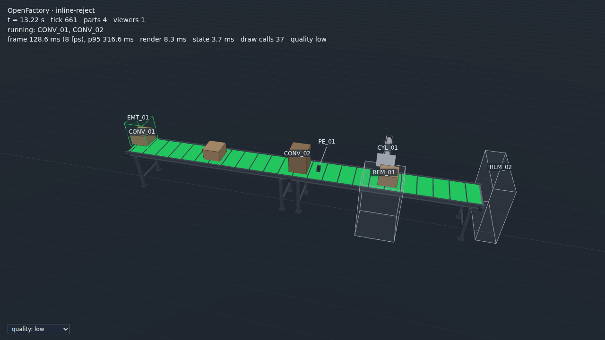

# Inline reject

`scenes/inline-reject.yaml` is an inspection line: two belts in line, a photo eye above the
good boxes, and a pusher that knocks each oversize box off the side of the line into a reject
bin. It is the first shipped scene **built only in the scene editor**: started with
`openfactory new`, then every component, field, connection and check set in the browser, with
no YAML written by hand. `tests/integration/test_editor_build.py` repeats that session click by
click and checks that the file it saves holds what the shipped file holds.

Training and demo use only. Not a safety-rated simulation, and the program is not a safety-rated
program.



## The plant

| Component | Type | What it does |
|---|---|---|
| `CONV_01` | belt conveyor | Infeed, 3 m along +x at 0.5 m/s |
| `CONV_02` | belt conveyor | Outfeed, 3 m, snapped onto `CONV_01`'s discharge in the editor (the connection came with the snap) |
| `EMT_01` | box emitter | A box every 3 s: `good` (0.2 m tall, 70 %) or `oversize` (0.4 m tall, 30 %) |
| `PE_01` | photo eye | 0.3 m above `CONV_02`, 0.5 m past the seam: only oversize boxes break the beam |
| `CYL_01` | pusher | 1.0 m past the eye, beside the belt; its 0.6 m stroke pushes a box off the far side |
| `REM_01` | part remover | The reject bin, across the belt from the pusher |
| `REM_02` | part remover | The end of the line, for good boxes |

## I/O

No analog tags, so both lockfiles give the same addresses.

| Tag | Modbus | OpenPLC | Meaning |
|---|---|---|---|
| `CONV_01_RUNNING_DI` | DI:0 | `%IX100.0` | Infeed running |
| `CONV_02_RUNNING_DI` | DI:1 | `%IX100.1` | Outfeed running |
| `CYL_01_EXTENDED_DI` | DI:2 | `%IX100.2` | Pusher extended |
| `PE_01_DI` | DI:3 | `%IX100.3` | Oversize box at the eye |
| `SIM_HEARTBEAT_DI` | DI:4 | `%IX100.4` | Simulator heartbeat, 1 Hz (every scene has it; PLAN §6.1) |
| `CONV_01_RUN_DO` | CO:0 | `%QX100.0` | Infeed run |
| `CONV_02_RUN_DO` | CO:1 | `%QX100.1` | Outfeed run |
| `CYL_01_EXTEND_DO` | CO:2 | `%QX100.2` | Extend the pusher |
| `EMT_01_DO` | CO:3 | `%QX100.3` | Box source enable |

The tag names are the ones the editor proposed: `ID_PORT_KIND`, or `ID_KIND` for a component
with one port (`PE_01_DI`, `EMT_01_DO`).

## The program

`examples/openplc/inline-reject.st` (OpenPLC) and `examples/pyplc/inline-reject.py` (the
stand-in script) run the same sequence: run both belts; enable the box source once both have
reported running for 1 s; on each rising edge of `PE_01_DI` start that box's own timer for its
2.08 s travel to the plate (a ring of four, as on `sorting-by-height`), then extend `CYL_01`;
retract on the extended limit.

```bash
uv run openfactory run scenes/inline-reject.yaml --script examples/pyplc/inline-reject.py
uv run openfactory test scenes/inline-reject.yaml --script examples/pyplc/inline-reject.py
```

The scene's checks: every oversize box reaches `REM_01` and every good one `REM_02`, none is
lost, and none takes longer than 15 s from spawn to bin (11.8 s measured over 60 s and 300 s
under the stand-in script). Under the stand-in script, 60 s puts 2 oversize boxes in the reject
bin and 14 good ones at the end of the line.

## How it was built

```bash
uv run openfactory new scenes/inline-reject.yaml    # one belt conveyor; opens the editor
```

In the editor:

1. **CONV_01** (the starter belt): description, length 3, and its `running` feedback bound with
   the **Use CONV_01_RUNNING_DI** button.
2. **Add** a belt conveyor with the view centred just past `CONV_01`'s discharge: it snaps on
   (ends meeting, facing) and the connection `{from: CONV_01, to: CONV_02}` is added. Length 3,
   feedback bound.
3. **Add** a box emitter, a photo eye, a pusher and two part removers. Each lands clear of the
   plant; its position, size and stroke are then typed in the form, its parts list written as
   one line of YAML, and its optional ports bound with their **Use** buttons.
4. With nothing selected, the panel shows the **scene** settings (description, author, seed) and
   its **checks** (`parts_reached`, `none_lost`, `max_cycle_s`).
5. **Save**. Save stays disabled while the scene or any component still has its placeholder
   description.

Then `openfactory export` (once per analog encoding) wrote the two lockfiles and
`inline-reject.CONTEXT.md`; the editor never writes lockfiles. What was awkward along the way,
and what was fixed, is in PLAN 4.1h.
