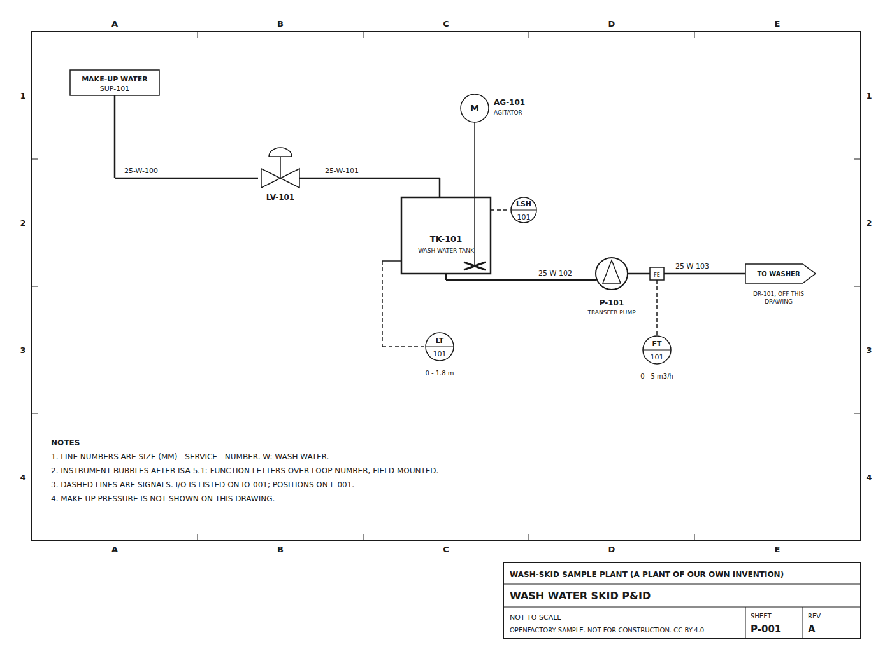
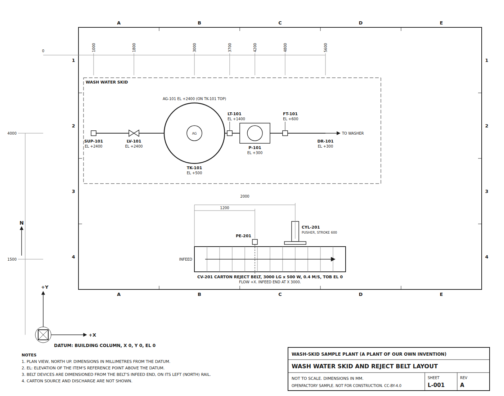

# The takeoff: from drawings to a scene

A plant's drawings (P&IDs, a layout, an I/O list) are read into a **takeoff**: a table a person
checks against the drawings, row by row, before any scene exists (PLAN 5.1). The scene is then
made from the takeoff, never typed from the drawings. Reading a drawing is error-prone. A table
with a sheet reference, a confidence mark and the open questions on every row is something a
person can check.

OpenFactory is a training and demo tool, not a safety-rated simulation. A customer's drawings,
and the takeoff and scene made from them, never enter this repository; the sample here is a
plant of our own invention, `docs/samples/wash-skid/`.

## The sample drawing set

`docs/samples/wash-skid/` is a plant of our own invention, drawn for practice and for tests
(CC-BY-4.0, `LICENSE.txt` beside it): a P&ID, a layout, an I/O list, and the takeoff read from
them. A practice run reads the PNGs, as it would a scanned or exported customer sheet.

- **P-001**, the P&ID: a make-up supply through level control valve LV-101 into tank TK-101,
  with LT-101, LSH-101 and agitator AG-101; transfer pump P-101 through FT-101 to the washer,
  off the drawing. Line numbers on every line; zones A to E across, 1 to 4 down.

  

- **L-001**, the layout in plan, north up, dimensioned in millimetres from a building column
  (the datum, with its axes drawn), elevations as `EL`, the belt's devices from its infeed end.

  

- **IO-001.csv**, the I/O list, in the I/O CSV's columns plus `plc_tag`. Row 15 is printed
  abbreviated (`CYL201 RET`), as real lists sometimes are; the takeoff's IO-15 infers the member
  name and asks about it.
- **wash-skid.takeoff.yaml**, the takeoff. It passes `check`; `--strict` fails it on its six
  open questions, as it should until they are answered and the file is marked again.

The SVGs are written by `tools/make_sample_sheets.py` from primitives only (lines, rectangles,
circles, polygons, text; instrument bubbles after the public ISA-5.1 convention) and rendered
to PNG by `tools/render_sheets.py` through Playwright's Chromium, which records each SVG's
SHA-256 in its PNG.

## The file

`<plant>.takeoff.yaml` is YAML with its own version, `takeoff: "0.1"`, and a JSON Schema,
`web/public/takeoff.schema.json`. Unknown keys are errors at every level.

```yaml
takeoff: "0.1"
plant: {name: wash-skid, description: Wash-water tank and a carton reject belt., author: HIS Controls}
drawings:
  - {id: P-001, kind: pid, title: Wash Water Skid P&ID, rev: A}
  - {id: L-001, kind: layout, title: Wash Water Skid and Reject Belt Layout, rev: A,
     frame: {units: mm, datum: [-3.0, 0, 4.0], rotation_deg: 0}}
  - {id: IO-001, kind: io_list, title: Wash Water Skid I/O List, rev: A}
checked: {by: XX, date: 2026-11-17, drawings: [P-001@A, L-001@A, IO-001@A], rows: 1e822ddb5b17bd3a}
equipment:
  - {row: EQ-3, tag: TK-101, type: tank, description: Wash Water Tank,
     params: {diameter: 1.2, height: 1.8, initial_level: 0.9, hi_level: 1.6},
     ref: [{sheet: P-001, grid: C2}, {sheet: L-001, grid: B2}],
     layout: {sheet: L-001, x: 3000, y: 4000, elevation: 500}, confidence: read, questions: []}
  - {row: EQ-10, tag: PE-201, type: photo_eye, description: Carton Reject Belt Photo Eye,
     params: {beam_length: 0.6}, ref: [{sheet: L-001, grid: C4}],
     mount: {conveyor: CV-201, sheet: L-001, along: 1200, rail: left}, confidence: read, questions: []}
connections:
  - {row: CN-3, from: TK-101.bottom, to: P-101.suction, line: 25-W-102,
     ref: [{sheet: P-001, grid: D2}], confidence: read, questions: []}
io:
  - {row: IO-4, equipment: LT-101, port: pv, signal: AI, plc_tag: LT101_PV,
     range: [0, 1.8], units: m, ref: [{sheet: IO-001, row: 4}], confidence: read, questions: []}
```

The whole sample is `docs/samples/wash-skid/wash-skid.takeoff.yaml`.

- **Rows.** `equipment`, `connections` and `io`, each with its own `row` id (`EQ-3`, `CN-3`,
  `IO-4`), never reused. An equipment row has the tag on the drawing, a built-in `type` (or
  `unknown`), an ISA-5.1 style `description` and the type's `params` as read. Its scene id is
  the tag with `-` as `_` unless `id:` says otherwise.
- **Where it was read.** `ref` lists every place the row appears: a sheet and its grid zone, or
  a list and its row. An `assumed` row with no `ref` is an item the drawing does not show.
- **Confidence.** `read` (printed on the drawing), `inferred` (deduced from it) or `assumed`
  (not on it).
- **Open questions.** `questions` per row; empty when none.
- **I/O.** Each row names an equipment tag, the type's port and its signal. The scene tag is
  `<ID>_<CODE>_<KIND>` (`LT_101_PV_AI`; `run` and `running` are `RUN`, `detect` adds no code,
  the design note's table gives the rest) unless `scene_tag:` gives one. `plc_tag` is the
  plant's own name ([the scene format](scene-format.md), `plc_tag:`).
- **Nothing in a takeoff is evaluated.** It is read with the safe YAML loader, at most 2 MB, and
  each parameter is a literal value handed to the scene as written.

### Positions as the drawing gives them

A layout sheet carries a `frame`: the `units` its dimensions are printed in (`mm`, `m`, `in`,
`ft`), where its datum is in the scene (`datum`, metres) and how its axes are turned
(`rotation_deg`). A row drawn on it gives its position as printed:

- **`layout: {sheet, x, y, elevation}`**: from the datum, `x` to the right on the sheet, `y` up
  the sheet, `elevation` above the datum, in the sheet's units, for the point the type's
  `position` names in the [component reference](components.md). The tool converts it:
  `scene = datum + rotate_y((x·u, elevation·u, -y·u), rotation_deg)`. At `rotation_deg: 0`
  the sheet's x is the scene's +x and up the sheet is the scene's -z. An optional `heading_deg`
  gives the item's own direction on the sheet (a belt drawn up a turned sheet); its scene
  heading is the frame's rotation plus it.
- **`mount: {conveyor, sheet, along, rail}`**: a device on a belt or roller conveyor's rail,
  `left` or `right` looking from the infeed, `along` from the infeed end in the sheet's units
  (metres with no `sheet`). The scene position is what the editor's drop rule gives
  (`core/mounts.place_on_rail`). An `along` outside the belt is an error, never clamped.
- **`at: [x, y, z]`** in scene metres, for a row on no layout sheet.

### The checked mark

A person checks the takeoff against the drawings and records it with one mark for the file:
`checked: {by, date, drawings: [<sheet>@<rev>, ...], rows: <digest>}`. `rows` is a digest of the
`drawings`, `equipment`, `connections` and `io` lists as YAML loads them, so comments, key order
and flow or block style do not change it, and any changed value does. The mark is **stale** when
a sheet's revision is not the one it names, or when a row changed after checking. Nobody writes
it by hand: `takeoff check --mark INITIALS` does.

## `openfactory takeoff check TAKEOFF`

```bash
openfactory takeoff check docs/samples/wash-skid/wash-skid.takeoff.yaml
openfactory takeoff check docs/samples/wash-skid/wash-skid.takeoff.yaml --strict
openfactory takeoff check my-plant.takeoff.yaml --mark JH
```

It prints the rows by confidence, every finding with its row and its sheet, the open questions
by row, and whether the mark is current. It writes nothing, except with `--mark`. Exit 1 on any
error.

**Refused before any check** (the file is read as data, never as code): a file over 2 MB; a
YAML tag; a key written twice in one mapping (YAML would keep the last one silently), named with
its line; an anchor, alias or merge key (`&`, `*`, `<<`), which a takeoff has no use for.

**Errors:** the schema (an unknown key, a wrong value; text holding a line break, a tab or any
other control character, since every text is one line); a parameter in `params` that the row's
type does not have, of the wrong type, or one of `id`, `type`, `description`, `position`,
`rotation_deg`, `mesh` and `io`, which the row sets itself; a duplicate row id, tag, scene id, scene
tag or `plc_tag`; a `ref` to a sheet not in `drawings`; an unknown type (write `unknown` for an
item with no type yet); a connection end that is not an equipment tag, or a port its type does
not have (a tank's `bottom`, `top` and nozzles, a link's pipe ports); an I/O row on a missing
item or port, or whose `signal` is not the port's kind; a `plc_tag` outside the grammar; a
scene tag that is not a valid tag (give `scene_tag:`); `range` on a discrete signal; more than one
of `layout`, `mount` and `at`; a `layout` or `mount` on a sheet not in `drawings` or with no
`frame`; a frame with another unit or a datum that is not three numbers; a `mount` on something
that is not a belt or roller conveyor, of a type not placed on a rail, on a rail other than
`left` or `right`, or with `along` outside the belt; a line the scaffold would make into a pipe
whose id (`PIPE_101`, ...) is another row's scene id (give that row an `id:`).

**Warnings:** `type: unknown` (the scaffold places a stand-in carrying its I/O); an `at:` row
whose `ref` names a layout sheet (the drawing could have given its position).

**`--strict`** also fails on any open question and on a missing or stale mark, saying why:

```text
checked: stale, rows changed since checking
FAIL (--strict): checked: stale, rows changed since checking
```

or `checked: stale, L-001 is rev B, checked at rev A`. It is the gate before a scaffold is shown
to anyone.

**`--mark INITIALS`** writes the mark when there is no error: the initials, today's date, each
sheet with its revision, and the rows digest. It replaces only the `checked:` key (or adds it at
the end), so no other byte of the file changes. It does not need `--strict` to pass: marking is
how a person records that the open questions were read.

## `openfactory takeoff scaffold TAKEOFF -o SCENE`

```bash
openfactory takeoff scaffold docs/samples/wash-skid/wash-skid.takeoff.yaml -o wash-skid.yaml
```

It writes a scene skeleton from a takeoff that passes `check` and prints a report. It refuses a
takeoff with any error and writes nothing; it never overwrites a scene without `--force`, and
never writes inside the project's `scenes/` folder without `--in-scenes`. It writes only the
path it is given.

**Every row has exactly one outcome**, and the report shows they add up to the takeoff's rows:

| Row | What the scene gets | Reported as |
|---|---|---|
| A known type with what it needs | the component, its description and parameters, a comment naming the row and sheet | placed |
| A row marked `assumed`: equipment, connection or I/O | the same, the component's comment saying `assumed` | assumed |
| `type: unknown` (or no `type`) | a stand-in: a local composite `standin_<id>`, a `scenery` body sized from `length`, `width`, `height` (else 1 m) whose io are exactly the row's I/O rows: each DO and AO a command, the first DI following the first DO, the first AI the first AO, any other DI false and any other AI the low end of its range; its description starts `PLACEHOLDER` | stand-in, with each of its I/O rows |
| No position, or a parameter with no default missing | placed in a holding row past the plant's far edge, 1.5 m apart (a missing parameter is a comment to fill in) | unplaced |
| A connection between two conveyors | a `connections:` entry | placed |
| A connection into a valve or pump | that link's `from` | placed |
| A connection from a link to a tank nozzle, supply, drain or junction, or between two of those | a `pipe` (`PIPE_101`, ...) sized from the line number (`25-W-101`: 25 mm), and the link's `to` names it | placed |
| Any other connection (a conveyor to a tank) | a `# NOT CONNECTED` comment at the end | not connected |
| An I/O row | the binding `{tag, plc_tag}` with its `range` and `units` | placed |

A row's outcome is the first that applies: unplaced or not connected, then stand-in (a
stand-in's I/O rows too), then assumed, then placed. A parameter a row leaves out that has a
documented default is left out of the scene too, so the type's default applies; it is not
marked in the scene and does not make the row assumed.

Each open question, on any row, is a `# QUESTION (<row>): <text>` comment above its component,
and is listed apart. Every comment is one line: a line break can never reach the scene from a
takeoff. Before it writes, `scaffold` loads the scene it made (a key written twice refused, then
the scene loader); a scene that does not load is a bug in `scaffold`, reported with the loader's
message, exit 1, and nothing is written. That load is skipped only when a row is unplaced for a
parameter with no default, since that scene cannot load until a person gives it. The report also says where each position came from: a layout sheet's
dimensions, a rail, or scene metres with no layout sheet. Devices on a rail sit where
`place_on_rail` puts them.

The sample's report:

```text
wash-skid.takeoff.yaml -> wash-skid.yaml: 32 rows (13 equipment, 4 connections, 15 I/O)
  placed         25
  assumed         4   EQ-1 SUP-101; EQ-8 DR-101; EQ-12 EMT-201; EQ-13 REM-201
  stand-in        3   EQ-5 AG-101 (type unknown: standin_ag_101); IO-5 -> run; IO-6 -> running
  unplaced        0
  not connected   0
  25 + 4 + 3 + 0 + 0 = 32: every row accounted for
positions: 9 from L-001 dimensions (EQ-1, EQ-2, EQ-3, EQ-4, EQ-5, EQ-6, EQ-7, EQ-8, EQ-9); 2 on CV-201's left rail (L-001) (EQ-10, EQ-11); 2 in scene metres with no layout sheet (EQ-12 EMT-201, EQ-13 REM-201)
open questions, written as # QUESTION comments (6): EQ-1, EQ-5, EQ-8, EQ-12, EQ-13, IO-15
```

**Exit codes:** 0 when every row is placed with no stand-in, no assumption and no question; 3
when the scene was written with rows to resolve; 1 when nothing was written. A script cannot
mistake 3 for a clean build. The scene has no `checks:` and no stand-in script: those come from
the plant's sequence of operations, which a takeoff does not hold. Until a PLC program is
written against it, `openfactory lint` reports only W201 and W202 ("no PLC side") on it. Two
runs write the same bytes.
